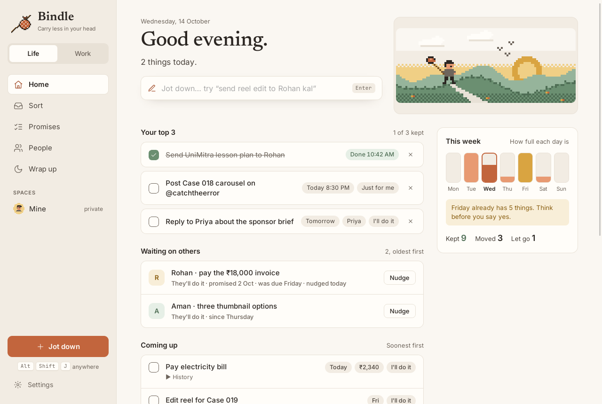
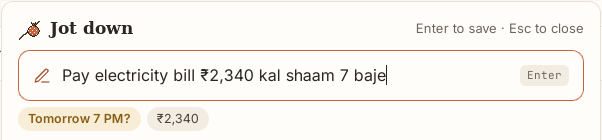
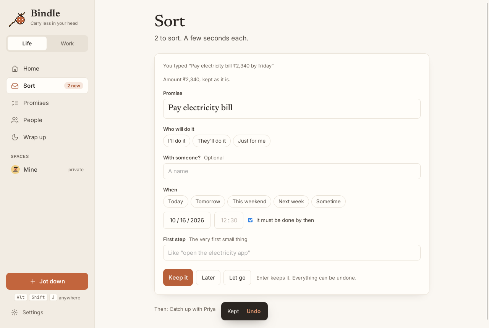
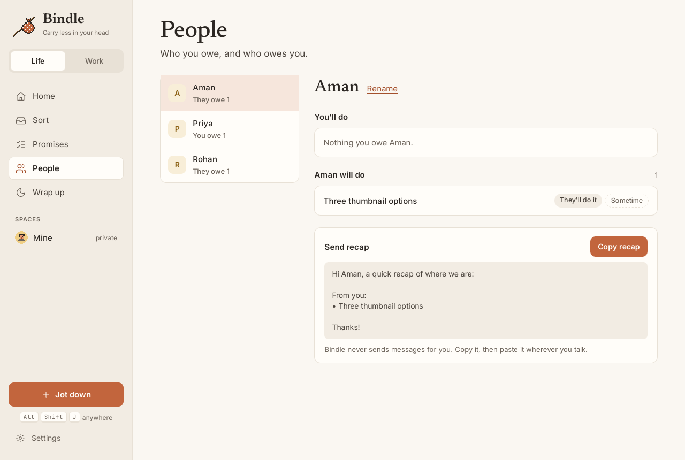
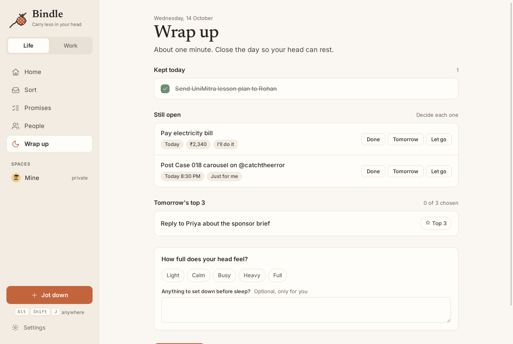
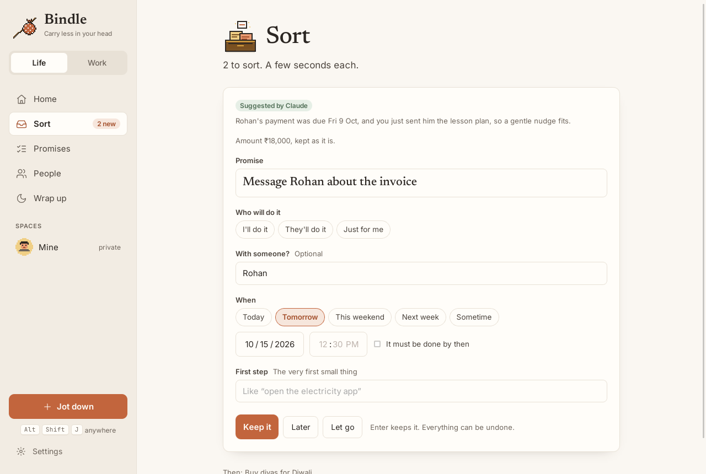
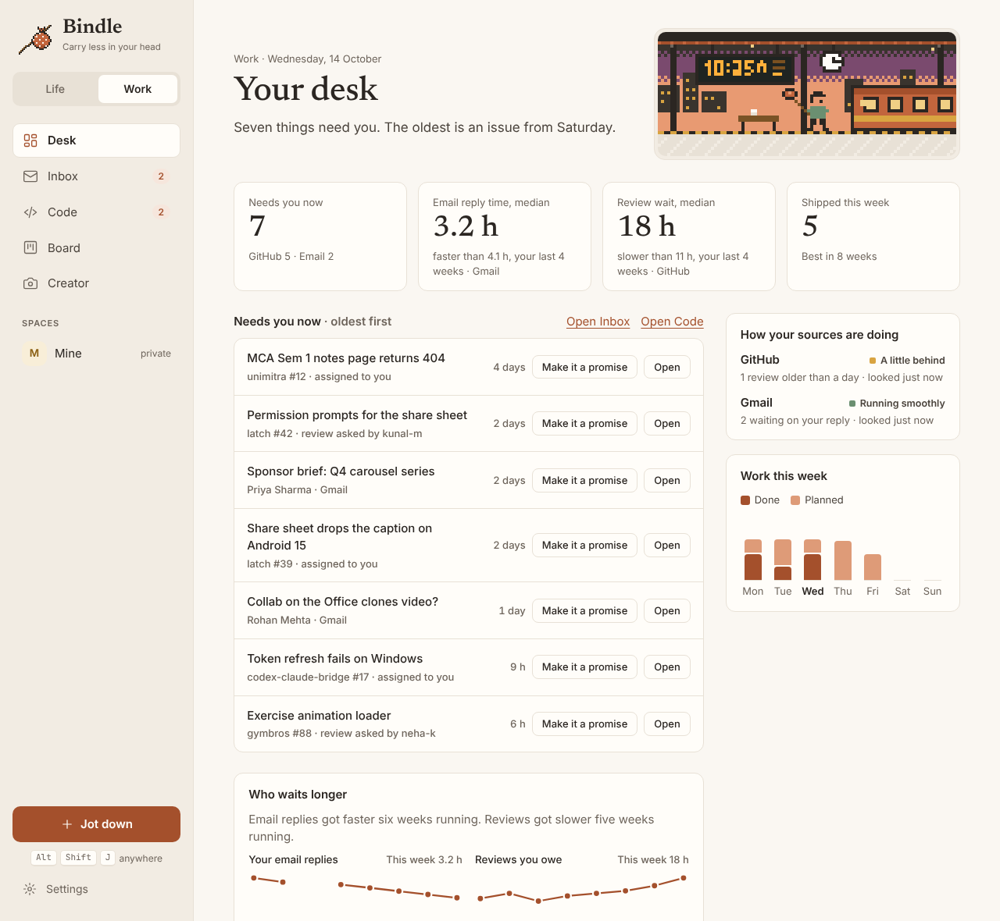
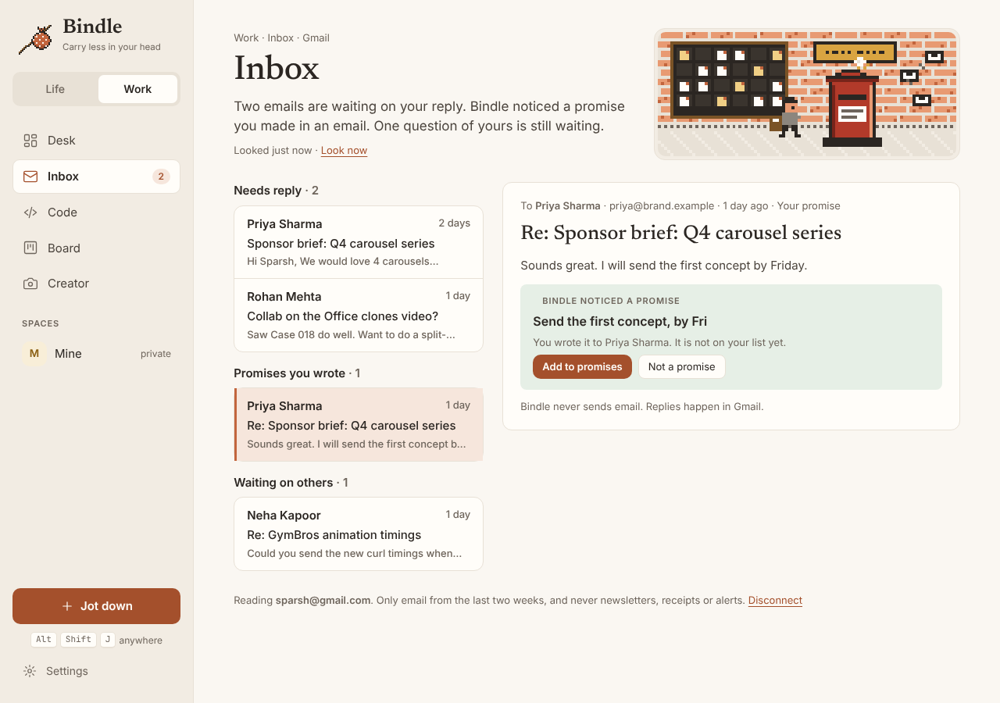
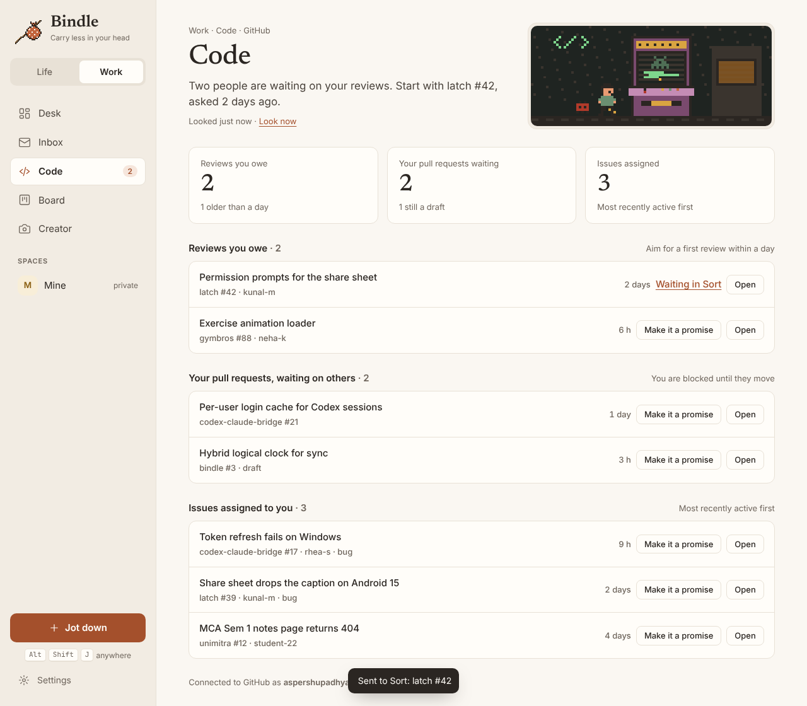

<p align="center">
  
</p>

<h1 align="center">Bindle</h1>

<p align="center"><b>Everything that needs you, in one bag.</b><br>
A calm, local-first app that carries your promises, from your life and your work, so your head doesn't have to.</p>

<p align="center">
  
</p>

> **Status: early.** The handbook and designs are done, the Rust core has its first tested crates, and the desktop app opens, and Jot down works from anywhere with Alt+Shift+J, understanding days, times, money and people in English and Hinglish. Sort turns each jot into a real promise, every change can be undone, and Home shows your top 3, what is running late, what others owe you and how full the week is. Promises lists everything by state with search across all of it (Ctrl+K), and People shows what you and each person owe each other, with a recap you can send. Wrap up closes the day in about a minute, reminders are quiet by default (at most three a day), and a new person reaches Home in under a minute. An AI app such as Claude can connect over MCP, when you allow it, to read Home and suggest promises that wait in Sort for you. Everything exports to JSON or CSV, and safety copies are made every day. Week 8 added accessibility checks, Linux fixes, a release workflow and updates from inside the app. Weeks 9 and 10 bring Work mode to life: connect GitHub and the Code screen shows the reviews people are waiting on, your pull requests and your issues, and any of them becomes a promise in one click. Weeks 11 and 12 add Gmail and the Board: Inbox shows who is waiting on your reply, your questions still waiting, and promises you wrote in an email, and the Board lays out work promises from Ideas to Shipped. Weeks 13 and 14 add the Work Desk: everything that needs you at work, oldest first, how long people wait on your replies and reviews compared with your own last four weeks, what shipped, and how each source is doing. See [docs/STATUS.md](docs/STATUS.md) for what is done and what is left.

<p align="center">
  
</p>
<p align="center">
  
</p>
<p align="center">
  
</p>
<p align="center">
  
</p>
<p align="center">
  
</p>
<p align="center">
  
</p>
<p align="center">
  
</p>
<p align="center">
  
</p>
<p align="center">
  
</p>

## What Bindle is

Bindle remembers every promise in your life, the ones you make and the ones made to you. You jot things down in two seconds, sort them once a day, and see what matters on one calm Home screen.

It has two modes and two kinds of space:

| | |
|---|---|
| **Life** | The calm promise ledger: Home, Sort, Promises, People, Wrap up. No scores, no red, no streaks. |
| **Work** | A focused desk: what needs you across Gmail, GitHub and your channels, a board, and real analysis of how long people wait on you. |
| **Mine** | Private. Only you, on your devices. |
| **Ours** | Shared with your partner or family through Bindle Cloud, end-to-end encrypted. |

## Designs

Hand-crafted screens with a warm paper palette and a hand-made pixel art layer. Every page has its own small pixel scene in its header. These are from v2 of the design; v1 is kept unchanged next to it.

| Work Desk | Code |
|---|---|
|  |  |
| **Creator, all accounts** | **Creator, one account** |
|  |  |
| **Inbox** | **Board** |
|  |  |
| **Life Home** | **Ours** |
|  |  |

The brand sheet is in [docs/design/v2/brand.png](docs/design/v2/brand.png). The design source files, sprites and render script are in [design/](design/README.md).

## Download

Installers for Windows, macOS and Linux are on the [releases page](https://github.com/aspershupadhyay/bindle/releases/latest), and on the download page at https://aspershupadhyay.github.io/bindle/ (built from `site/`). The builds are not signed yet, so Windows and macOS ask once before opening; the download page says how.

## Tech stack

| Layer | Choice |
|---|---|
| App shell | Tauri 2 (desktop first, iOS and Android later) |
| Core | Rust workspace: `bindle-core`, `bindle-parse`, `bindle-store`, `bindle-sync` |
| Local data | SQLite (bundled, WAL, FTS5); SQLCipher once cloud is on |
| UI | React, TypeScript, Vite, Radix, cmdk, TanStack Query, Zustand, Motion |
| Charts and board | Custom SVG on d3-scale and d3-shape; dnd-kit |
| Work sources | GitHub (personal access token) and Gmail (IMAP with an app password), both read only; then Microsoft Graph, YouTube and Instagram Graph (OAuth with PKCE). Tokens and passwords live in the OS keychain |
| AI connection | MCP server in Rust over stdio (`bindle --mcp`), off by default; read only or read and suggest |
| Bindle Cloud | Rust (Axum) sync server, Postgres on Supabase, Fly.io, Cloudflare R2 backups |
| Sync | Hybrid logical clocks, field-level merges, XChaCha20-Poly1305 and X25519 end-to-end encryption |

## Repository layout

```
bindle/
  app/
    src/             React views: first run, Home, Sort, Promises, People, Wrap up, Settings, the Jot down window
    src/art/         pixel sprites at 1x (scale by whole numbers only)
    src/tokens.css   design tokens
    src-tauri/       the Tauri desktop app, its typed commands and the reminder thread
  crates/
    bindle-core/     promise rules: states, allowed changes, running late
    bindle-parse/    understands what you type: days, times, money, people, English and Hinglish
    bindle-store/    SQLite schema, migrations, Sort, history, Undo, Home, People, search, AI rules, export and safety copies
    bindle-sync/     hybrid logical clocks and merges for Bindle Cloud
    bindle-mcp/      the AI connection: an MCP server that reads and suggests, never changes
  design/            design sources, sprites and render tools
  docs/              handbook mirror and designs
```

Where things stand: [docs/STATUS.md](docs/STATUS.md). Acceptance checks: [docs/ACCEPTANCE.md](docs/ACCEPTANCE.md). Releasing: [docs/RELEASING.md](docs/RELEASING.md).

Alt+Shift+J is claimed system-wide where the desktop allows it. Some Wayland sessions do not let apps claim global shortcuts; there it works inside Bindle, and the Jot down button is always there.

## Build and test

You need Rust (stable), Node 22, and on Linux the WebKitGTK libraries (`sudo apt install libwebkit2gtk-4.1-dev librsvg2-dev` on Debian and Ubuntu; see the [Tauri prerequisites](https://v2.tauri.app/start/prerequisites/) for other systems).

```sh
cd app && npm install

npm run tauri dev        # run the desktop app
npm run dev              # views only, in a browser, with an in-memory preview (nothing saved)
```

Checks, the same as CI:

```sh
(cd app && npm run typecheck && npm test && npx vite build)
cargo fmt --all -- --check
cargo clippy --workspace --all-targets -- -D warnings
cargo test --workspace
```

The views must be built (`npx vite build`) before the Rust workspace compiles, because the desktop app embeds them.

## Connect an AI app

Bindle can talk to Claude Desktop, Claude Code or any app that speaks the Model Context Protocol. It is off until you choose **Read only** or **Read and suggest** in Settings > AI connection, which also shows the exact block to paste into the app's MCP settings. It looks like this:

```json
{ "mcpServers": { "bindle": { "command": "/path/to/Bindle", "args": ["--mcp", "--db", "/path/to/bindle.db"] } } }
```

The AI can read Home, promises and people, and, if you allow it, suggest promises. Suggestions wait in Sort for you, at most 10 at a time. It can never change, finish or remove a promise, and Bindle never sends messages for anyone. People you mark "Keep from AI" are never shown to it, and Settings lists everything an AI read or suggested. For development, `cargo run -p bindle-mcp -- --db <path>` runs the same server on its own.

## Handbook

The full product handbook (product guide, design system, data model, screens, AI connection, cloud and build plan) lives in Notion and is mirrored in [docs/HANDBOOK.md](docs/HANDBOOK.md).

## Ownership and licence

Bindle is created, owned and led by **Sparsh Upadhyay** (Aspersh).
The code is licensed under the [Apache License 2.0](LICENSE); every copy must keep the [NOTICE](NOTICE) file.
The Bindle name and logo are not covered by the code licence; see [TRADEMARKS.md](TRADEMARKS.md).
