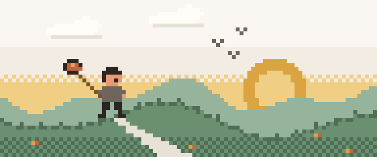
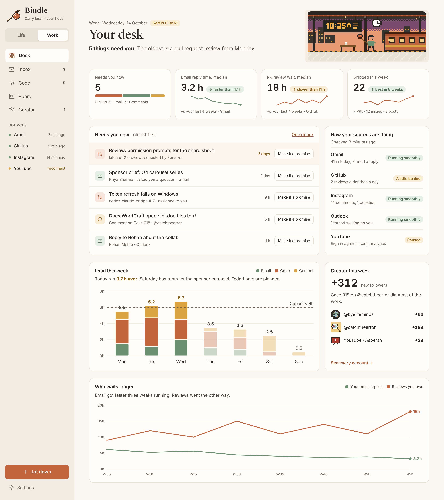
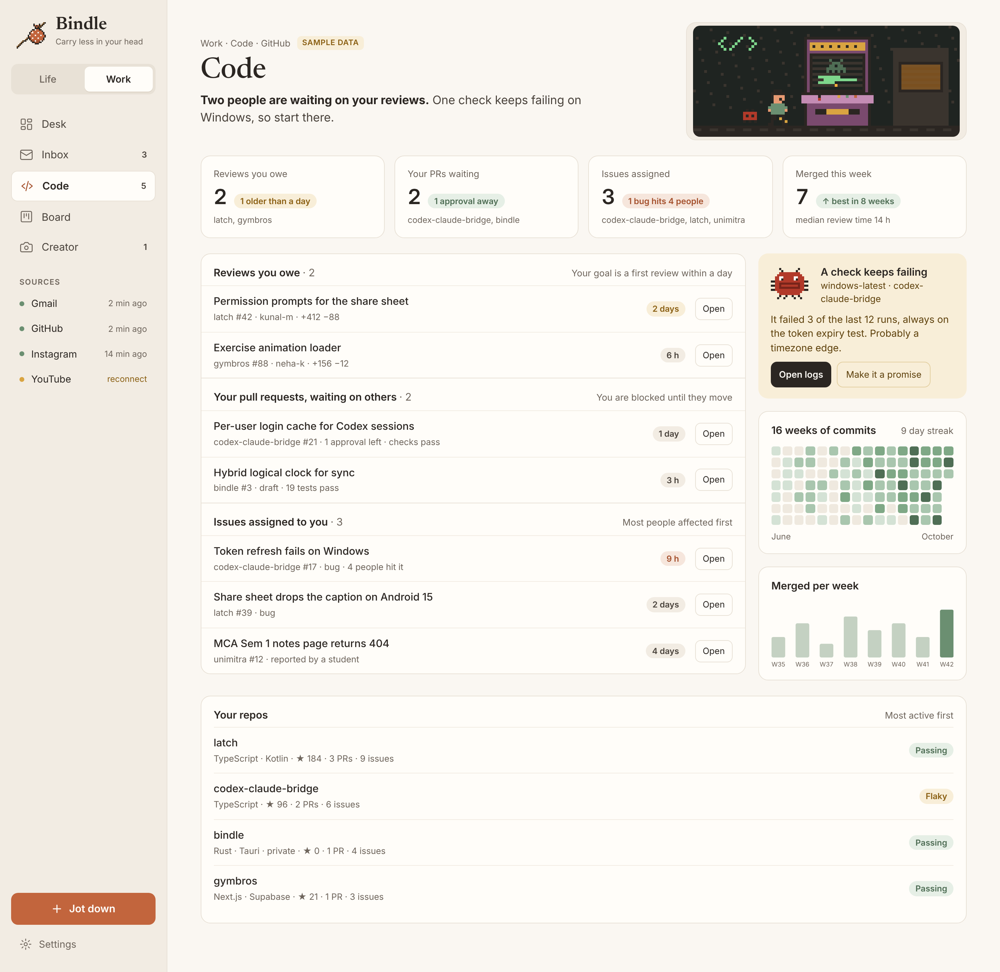
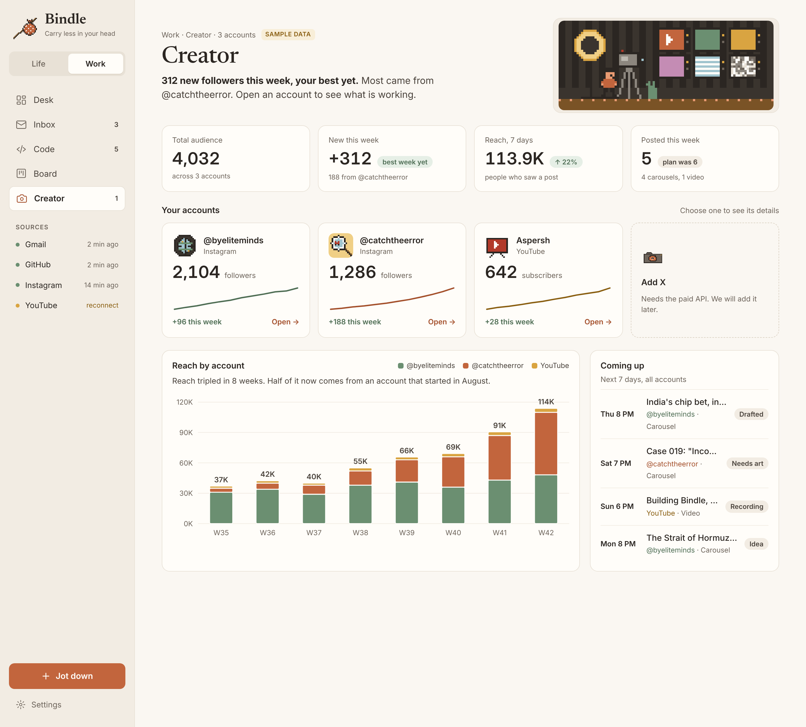
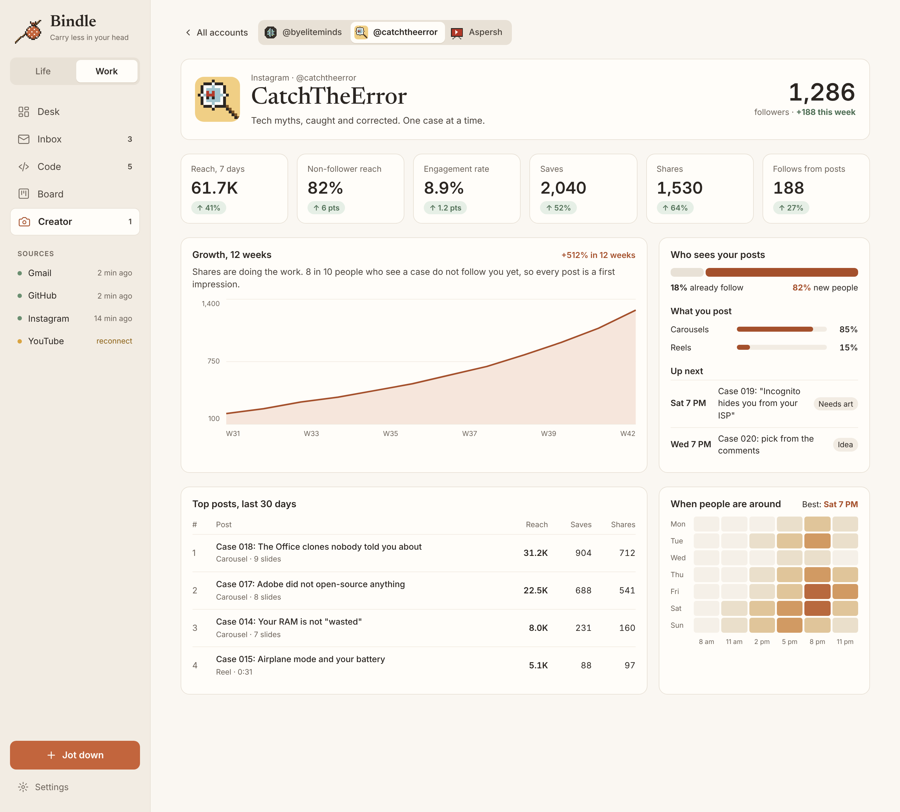
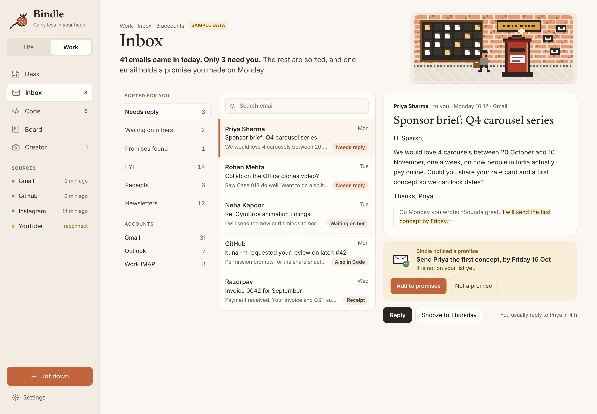
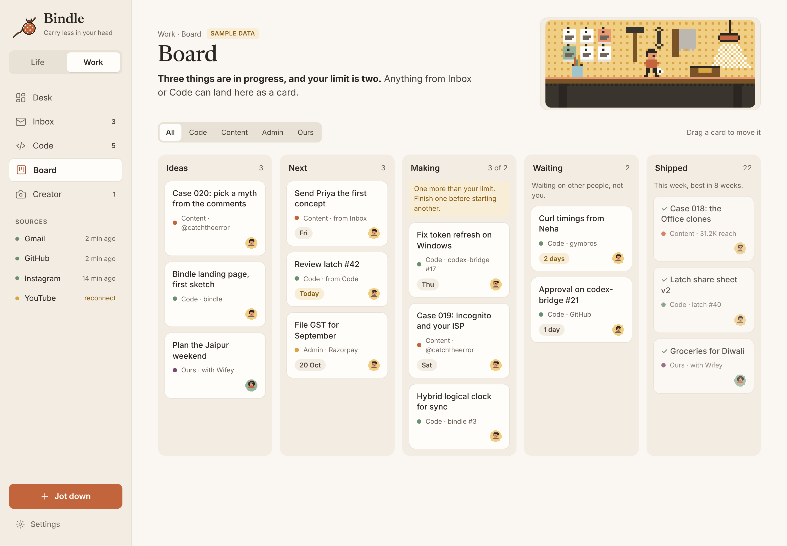
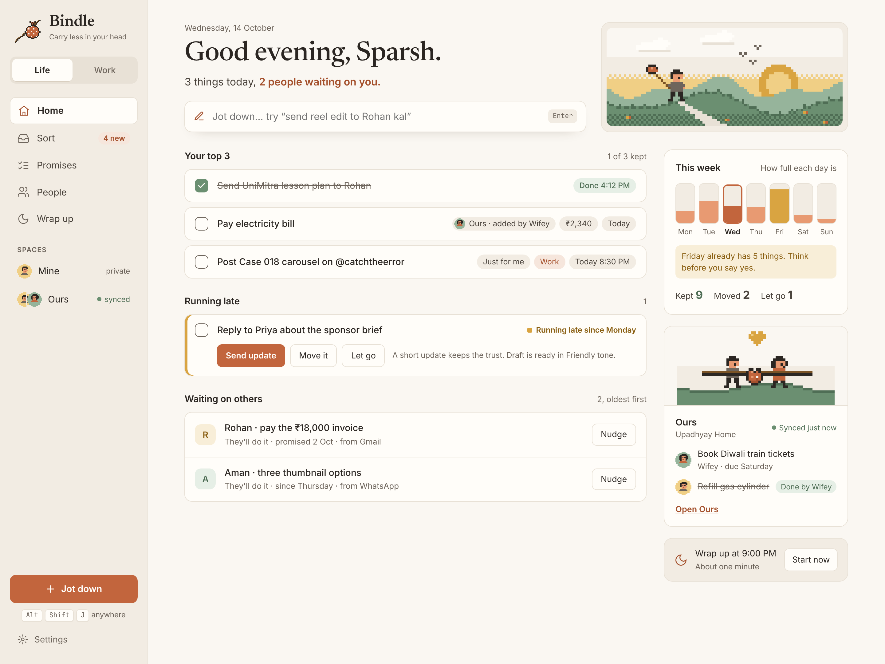
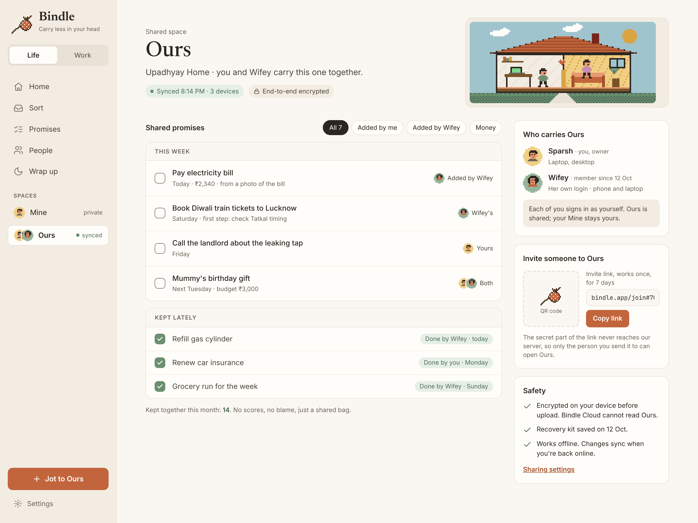

<p align="center">
  
</p>

<h1 align="center">Bindle</h1>

<p align="center"><b>Everything that needs you, in one bag.</b><br>
A calm, local-first app that carries your promises, from your life and your work, so your head doesn't have to.</p>

<p align="center">
  
</p>

> **Status: early.** The handbook and designs are done; the Rust core has its first tested crates. The desktop app is not built yet. Nothing here is ready to use.

## What Bindle is

Bindle remembers every promise in your life, the ones you make and the ones made to you. You jot things down in two seconds, sort them once a day, and see what matters on one calm Home screen.

It has two modes and two kinds of space:

| | |
|---|---|
| **Life** | The calm promise ledger: Home, Sort, Promises, People, Wrap up. No scores, no red, no streaks. |
| **Work** | A focused desk: what needs you across Gmail, GitHub and your channels, a board, and real analysis of how long people wait on you. |
| **Mine** | Private. Only you, on your devices. |
| **Ours** | Shared with your partner or family through Bindle Cloud, end-to-end encrypted. |

## Designs

Hand-crafted screens with a warm paper palette and a hand-made pixel art layer. Every page has its own small pixel scene in its header. These are from v2 of the design; v1 is kept unchanged next to it.

| Work Desk | Code |
|---|---|
|  |  |
| **Creator, all accounts** | **Creator, one account** |
|  |  |
| **Inbox** | **Board** |
|  |  |
| **Life Home** | **Ours** |
|  |  |

The brand sheet is in [docs/design/v2/brand.png](docs/design/v2/brand.png). The design source files, sprites and render script are in [design/](design/README.md).

## Tech stack

| Layer | Choice |
|---|---|
| App shell | Tauri 2 (desktop first, iOS and Android later) |
| Core | Rust workspace: `bindle-core`, `bindle-parse`, `bindle-store`, `bindle-sync` |
| Local data | SQLite (bundled, WAL, FTS5); SQLCipher once cloud is on |
| UI | React, TypeScript, Vite, Radix, cmdk, TanStack Query, Zustand, Motion |
| Charts and board | Custom SVG on d3-scale and d3-shape; dnd-kit |
| Work sources | Gmail, Microsoft Graph, GitHub, YouTube, Instagram Graph (OAuth with PKCE, tokens in the OS keychain) |
| AI connection | MCP server in Rust (`rmcp`), off by default |
| Bindle Cloud | Rust (Axum) sync server, Postgres on Supabase, Fly.io, Cloudflare R2 backups |
| Sync | Hybrid logical clocks, field-level merges, XChaCha20-Poly1305 and X25519 end-to-end encryption |

## Repository layout

```
bindle/
  crates/
    bindle-core/     promise rules: states, allowed changes, running late
    bindle-parse/    understands what you type, English and Hinglish
    bindle-store/    SQLite schema and migrations
    bindle-sync/     hybrid logical clocks and merges for Bindle Cloud
  app/src/art/       pixel sprites at 1x (scale by whole numbers only)
  app/src/tokens.css design tokens
  docs/              handbook mirror and designs
```

Coming next, in order: the Tauri shell, Jot down, Sort, Home (weeks 1 to 4 of the plan in [docs/ROADMAP.md](docs/ROADMAP.md)).

## Build and test

```sh
cargo test --workspace
cargo clippy --workspace --all-targets -- -D warnings
```

## Handbook

The full product handbook (product guide, design system, data model, screens, AI connection, cloud and build plan) lives in Notion and is mirrored in [docs/HANDBOOK.md](docs/HANDBOOK.md).

## Ownership and licence

Bindle is created, owned and led by **Sparsh Upadhyay** (Aspersh).
The code is licensed under the [Apache License 2.0](LICENSE); every copy must keep the [NOTICE](NOTICE) file.
The Bindle name and logo are not covered by the code licence; see [TRADEMARKS.md](TRADEMARKS.md).
